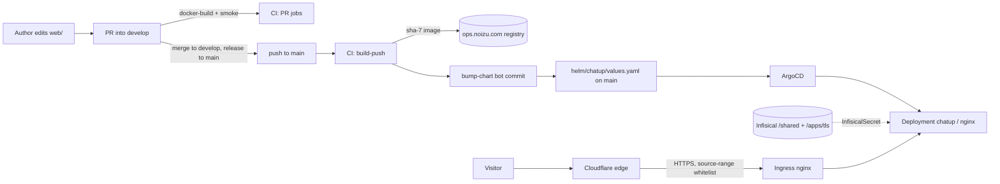

# Project Architecture

## Overview

`chatup.therobot.codes` is the public home page for **Chat to Markdown**, a
local-only Chromium extension (separate repo: `the-robot-lives/chat-to-markdown`).
This repository contains no extension code: it is a static marketing/privacy site,
built into a single nginx image and deployed to the shared `noizu` Kubernetes
cluster behind Cloudflare.

Architecturally the system is a **build-time artifact pipeline**, not a running
application. A file tree (`web/`) is baked into a container image by CI, a bot
commits the resulting image tag into a Helm chart, and ArgoCD reconciles that chart
into the cluster. At runtime there is exactly one process type — nginx serving
static bytes — with no backend, no database, no session state, and no
server-side code path that can execute user input.

→ *Components ↔ directories: see [PROJ-LAYOUT.md](PROJ-LAYOUT.md)*

## System Diagram

## Core Components

| Component | Purpose | Implements |
|-----------|---------|------------|
| Static site bundle | Landing page, privacy policy, crawler files, icons | `web/` |
| nginx config | Routing (`try_files`), 7-day asset cache, security headers, `/nginx-health` | `web/nginx.conf` |
| Image definition | `nginx:alpine`, stage named `production`, copies `web/` over the default docroot | `Dockerfile` |
| Local sandbox | `make sandbox` builds and runs the image on `127.0.0.1:8787` | `Makefile` |
| Chart | Domain, image tag, TLS/Infisical wiring for this site | `helm/chatup/values.yaml` |
| Vendored subchart | Reusable nginx static-site Deployment/Service/Ingress/InfisicalSecret | `helm/chatup/charts/static-site/` |
| CI pipeline | PR build+smoke; on `main` build, smoke, push `sha-*`, bump chart tag | `.github/workflows/ci.yml` |

## Build & Release Flow

- **PRs** (`pull_request`): `docker-build` compiles the `production` stage
  (linux/amd64, no push, gha cache), then `smoke` boots the image on port 8080 and
  polls `/nginx-health` (falling back to `GET /`) for up to 30s.
- **Push to `main`**: `build-push` logs into `ops.noizu.com`, builds, smokes, then
  pushes `ops.noizu.com/chatup.therobot.codes/web:sha-<7>`; `bump-chart` `sed`s that
  tag into `helm/chatup/values.yaml` and commits as `chatup-ci` with `[skip ci]`.
- **`stage`** is a workflow trigger branch but only runs the (skipped) PR-only jobs —
  release flow is `develop` → `stage` → `main` per the monorepo policy; ArgoCD
  tracks the chart in the repo, so a chart change on `main` is what actually deploys.
- Tags are **never** `:latest`; the chart tag is CI-owned and must not be hand-edited.

## Deployment Topology

- Namespace/deployment name `chatup` (`fullnameOverride`), 1 replica, ClusterIP
  service on port 80, probes on `GET /`.
- Ingress class `nginx`, TLS via secret `chatup-therobot-codes-tls`, and
  `nginx.ingress.kubernetes.io/whitelist-source-range` restricted to the Cloudflare
  edge ranges (`cloudflareOnly: true` in the subchart defaults).
- TLS material is **not** stored here: an `InfisicalSecret` pulls
  `/apps/tls/chatuptherobotcodes` (keys `CHATUP_TLS_CRT` / `CHATUP_TLS_KEY`) from
  `infisical.noizu.com` using the shared `universal-auth-credentials` in namespace
  `infra`, and materialises the `kubernetes.io/tls` Secret the Ingress references.
- Image pull uses `ops-registry-secret` (private registry).

→ *See [PROJ-SCHEMA.md](PROJ-SCHEMA.md) for the full config/interface schema of the chart and nginx.*

## Key Decisions

- **No JS framework.** One static HTML page with inline CSS beats a build toolchain
  for a one-pager; no npm/node in the repo at all.
- **Vendored `static-site` subchart.** `Chart.yaml` records why: the original
  `file://../../../../components` dependency path escaped the repo and ArgoCD could
  not resolve it, so the subchart is copied in-tree and auto-discovered under
  `charts/`. Trade-off: it can drift from the shared original (see threat `T-007`).
- **Cloudflare-only ingress.** Origin is reachable only through the Cloudflare edge;
  a 526 from Cloudflare means the origin cert does not cover `chatup.therobot.codes`.
- **CI owns the image tag.** Deploy is a git commit, not an imperative command, so
  ArgoCD can reconcile from the repo alone.

## Technology Stack

`nginx:alpine` · static HTML/CSS · Helm 3 · ArgoCD · GitHub Actions (buildx) ·
Infisical Operator · Cloudflare (edge TLS + origin cert) · `ops.noizu.com` registry.
