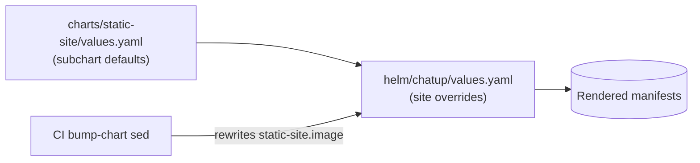

# Project Schema

## Scope

**There is no persistence layer in this repository.** No relational database, no
Liquibase changelog, no Ecto/SQL schema, no ORM, no KV store, no Redis/Valkey
usage, no message queue, and no mutable state of any kind. Nothing here survives a
pod restart because nothing is written: the container serves immutable files from
its image.

Because there is no relational schema, the Mermaid/PlantUML ERD sections of the
schema guide do not apply and are omitted — deliberately, not by oversight. What
*is* structured data in this repo falls into three of the guide's non-relational
kinds, documented below:

| Kind | Where | Form |
|------|-------|------|
| Config schema | `helm/chatup/values.yaml`, `helm/chatup/charts/static-site/values.yaml` | Helm values hierarchy (table + precedence graph) |
| Content/data files | `web/*.html`, `web/*.txt`, `web/sitemap.xml`, `web/icons/*` | Format spec + inventory table |
| Interface schema | `web/nginx.conf`, `.github/workflows/ci.yml` | Route table, header table, CI env/trigger contract |

Source locations map from [PROJ-LAYOUT.md](PROJ-LAYOUT.md).

## Config Schema — Helm Values

Values are layered: subchart defaults (`charts/static-site/values.yaml`) ← parent
overrides (`helm/chatup/values.yaml`) ← CI's `sed` bump of the image tag. Only the
parent file is site-specific.

### `helm/chatup/values.yaml` (site-specific)

| Key | Type | Value in repo | Meaning |
|-----|------|---------------|---------|
| `static-site.nameOverride` | string | `chatup` | Chart name override |
| `static-site.fullnameOverride` | string | `chatup` | Fixed resource name (Deployment/Service/Ingress) |
| `static-site.domain` | string | `chatup.therobot.codes` | Ingress host + TLS host |
| `static-site.extraHosts` | list | `[]` | Additional ingress hosts (unused here) |
| `static-site.image` | string | `ops.noizu.com/chatup.therobot.codes/web:sha-4d369a8` | **CI-managed**; `sha-<7>` of the deployed commit |
| `static-site.port` | int | `80` | Container + service port |
| `static-site.imagePullSecrets` | list | `ops-registry-secret` | Private registry credential |
| `static-site.tls.secretName` | string | `chatup-therobot-codes-tls` | TLS Secret materialised by the operator |
| `static-site.tls.infisical.enabled` | bool | `true` | Emit the `InfisicalSecret` CR |
| `static-site.tls.infisical.secretsPath` | string | `/apps/tls/chatuptherobotcodes` | Infisical folder |
| `static-site.tls.infisical.crtKey` | string | `CHATUP_TLS_CRT` | Key holding the origin certificate |
| `static-site.tls.infisical.keyKey` | string | `CHATUP_TLS_KEY` | Key holding the private key |

### `helm/chatup/charts/static-site/values.yaml` (shared defaults)

| Key | Type | Default | Meaning |
|-----|------|---------|---------|
| `replicas` | int | `1` | Replica count |
| `domain` / `extraHosts` | string / list | `example.com` / `[]` | Overridden per site |
| `image` | string | `nginx:alpine` | Overridden per site |
| `port` | int | `80` | Container and service port |
| `resources.requests` | map | `cpu 25m`, `mem 64Mi` | Scheduler floor |
| `resources.limits` | map | `cpu 100m`, `mem 128Mi` | Hard ceiling |
| `imagePullSecrets` | list | `[]` | Overridden per site |
| `ingress.enabled` | bool | `true` | Render the Ingress |
| `ingress.className` | string | `nginx` | IngressClass |
| `ingress.annotations` | map | `ssl-redirect: "true"`, `proxy-body-size: "10m"` | Copied verbatim into the Ingress |
| `ingress.cloudflareOnly` | bool | `true` | Adds the Cloudflare source-range whitelist |
| `tls.enabled` | bool | `true` | TLS block in the Ingress |
| `tls.secretName` | string | `static-site-tls` | Overridden per site |
| `tls.infisical.resyncInterval` | int (s) | `300` | Operator resync period |
| `tls.infisical.hostAPI` | string | `https://infisical.noizu.com/api` | Infisical API base |
| `tls.infisical.credentialsSecret` / `credentialsNamespace` | string | `universal-auth-credentials` / `infra` | Universal-auth identity reference |
| `tls.infisical.projectSlug` / `envSlug` | string | `k8-infra` / `prod` | Infisical project + environment |
| `tls.infisical.secretsPath` | string | `/shared/tls` | Overridden per site |
| `tls.infisical.caKey` | string | `""` | Optional `ca.crt`; empty ⇒ omitted from the Secret template |

**Invariants**: `tls.infisical.caKey` empty means the rendered `kubernetes.io/tls`
Secret has exactly two keys (`tls.crt`, `tls.key`); setting it requires the Infisical
folder to actually contain that key or the sync fails.

## Content & Data Files

| Path | Format | Shape | Consumer |
|------|--------|-------|----------|
| `web/index.html` | HTML5 + inline CSS | Landing page; `<head>` metadata, OpenGraph/Twitter cards, `application/ld+json` `SoftwareApplication` block (`softwareVersion: 0.6.0`, MIT, free offer), Google Analytics `gtag.js` (`G-N67LR8EK2E`) | Browsers, crawlers, store reviewers |
| `web/privacy.html` | HTML5 + inline CSS | Policy sections: no data collection, no retention, no accounts/analytics/tracking, permissions, "This website" | Chrome Web Store listing URL, users |
| `web/llms.txt` | Markdown-in-`.txt` | Title/summary block, `## Product`, `## Install`, canonical links | AI crawlers |
| `web/robots.txt` | robots.txt | `User-agent: *` / `Allow: /` + `Sitemap:` | Crawlers |
| `web/sitemap.xml` | XML sitemap | 2 `<url>` entries: `/` (weekly, 1.0), `/privacy` (yearly, 0.4) | Crawlers |
| `web/icons/icon{16,48,128}.png`, `web/favicon.png`, `web/apple-touch-icon.png` | PNG | Brand icons; `icon128` doubles as the page logo | Browsers, page markup |
| `CHANGELOG.md` | Markdown | `## YYYY-MM-DD` headings, one line per landed change | Maintainers |

`.dockerignore` excludes `helm/`, `.git`, `.github`, `*.md`, `Makefile` and
`Dockerfile`, so the image contains only `web/` plus the nginx config — the docs
and chart never ship.

## Interface Schema — HTTP Surface

`web/nginx.conf` (single server block, `server_name _`) defines the entire HTTP
contract:

| Route / handler | Matching | Behaviour |
|-----------------|----------|-----------|
| `/nginx-health` | prefix, `access_log off` | `200 "ok\n"` with `Content-Type: text/plain` |
| `~* \.(css\|js\|png\|jpg\|jpeg\|gif\|ico\|svg\|woff\|woff2\|ttf\|eot)$` | case-insensitive regex | `expires 7d` + `Cache-Control: public`; served from docroot |
| `/` | prefix fallback | `try_files $uri $uri.html $uri/index.html =404` — so `/privacy` resolves to `privacy.html`, `/` to `index.html` |

Response headers applied to every response (`always`):

| Header | Value |
|--------|-------|
| `X-Content-Type-Options` | `nosniff` |
| `X-Frame-Options` | `SAMEORIGIN` |
| `Referrer-Policy` | `strict-origin-when-cross-origin` |

gzip: on, `text/plain text/css application/json application/javascript text/xml
application/xml image/svg+xml`, min length 256 bytes. There is **no** CSP, HSTS, or
`Permissions-Policy` header (see `THREAT-MODEL.md` `T-002`/`T-006`).

## Interface Schema — CI Contract

`.github/workflows/ci.yml` triggers: `push` to `main` and `stage`; all
`pull_request`s. Concurrency group `ci-${{ github.ref }}` with `cancel-in-progress`.

| Env var | Value | Used by |
|---------|-------|---------|
| `REGISTRY` | `ops.noizu.com` | login, image ref |
| `IMAGE` | `ops.noizu.com/chatup.therobot.codes/web` | build/push tags |

| Job | Gate | Output |
|-----|------|--------|
| `docker-build` | `pull_request` | buildx build of target `production`, no push, gha cache scope `web` |
| `smoke` | needs `docker-build` | boots image on `:8080`, polls `/nginx-health` then `/`, 30×1s, ≤2 min |
| `build-push` | `push` and `ref == refs/heads/main` | pushes `:sha-<7>` after loading + smoking |
| `bump-chart` | needs `build-push`, `contents: write` | `sed` tag into `helm/chatup/values.yaml`, commit as `chatup-ci <ci@noizu.com>` with `[skip ci]`, `pull --rebase` then push |

Secrets consumed: `REGISTRY_USER`, `REGISTRY_PASSWORD` (repository secrets).
Push to `stage` matches the workflow but no job's `if` passes, so a stage push runs
nothing — the deploy path is a `main` push.
