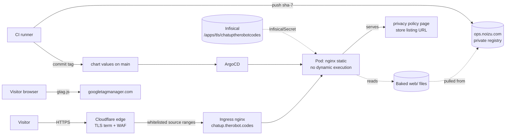

# Threat Model

## Overview

`chatup.therobot.codes` is a **static content site with no authentication, no
sessions, no user input handling, and no data store**. The crown jewels are
therefore not user data (there is none) but two narrower assets: (1) the
**integrity of the served bytes** — the page is the product's public face and the
**Chrome Web Store privacy-policy URL**, so a defaced page or a falsified policy
damages users' informed consent; and (2) the **deploy credential path** — registry
push credentials in CI and the origin TLS private key, either of which, if
compromised, lets an attacker publish content under this domain.

Trust boundaries, verified from source, are few: public internet ↔ Cloudflare edge ↔
cluster ingress ↔ nginx pod; CI runner ↔ image registry ↔ chart repo ↔ ArgoCD; and
Infisical ↔ cluster Secret. Within the pod there is no second boundary because
nothing executes input — nginx only maps request paths onto files baked into the
image.

This model is small because the system is small. It deliberately records the
*real* gaps (two of which are policy-accuracy and header gaps) rather than padding
a register.

## Attack Surface

Enumerated entry points (all in `web/nginx.conf`): `/nginx-health` (static string),
the asset regex location (static files, 7-day cache), and the `/` fallback
(`try_files`). There are no webhooks, no cron, no queue consumers, no API routes,
no form handlers, no upload paths, and no auth callbacks. Egress from the served
pages is limited to one third-party script (`gtag.js`) and outbound hyperlinks
(Chrome Web Store, GitHub, `therobotlives.com`, `therobot.codes`).

→ *See [PROJ-ARCH.md](PROJ-ARCH.md) for the deployed perimeter and [PROJ-SCHEMA.md](PROJ-SCHEMA.md) for the route/header contract.*

## Vulnerability Register

| ID | Severity | STRIDE | Component | Finding | Status |
|----|----------|--------|-----------|---------|--------|
| T-001 | Medium | Repudiation / Info disclosure | `web/index.html` + `web/privacy.html` | The landing page loads Google Analytics (`gtag.js`, `G-N67LR8EK2E`, added PR #3) while the privacy page states the site "does not run analytics" and "has no remotely hosted code", and the hero claims "no analytics". Visitor IP/User-Agent/referrer are sent to Google on every page view. | **Open** |
| T-002 | Medium | Tampering | `web/index.html`, `web/nginx.conf` | Third-party script is loaded without Subresource Integrity and **no Content-Security-Policy** is set, so a compromise of `googletagmanager.com` (or any script-src substitution) executes with full page origin privileges. Absence of CSP also removes defence-in-depth for the static HTML. | **Open** (partially bounded: no cookies, no auth, no session, no credentials on the page) |
| T-003 | Medium | Tampering / Elevation | CI (`build-push`, `bump-chart`) | Anyone able to write to `main` or to the registry can publish arbitrary content for this domain, and the deployed image is a *mutable tag* (`sha-<7>`) with no digest pinning or image signing. `imagePullPolicy: Always` means the registry is consulted on every restart. | Partial (write access is the control; no signing/digest) |
| T-004 | Low | Info disclosure | `web/privacy.html` | The privacy page is the Chrome Web Store listing URL, so its accuracy is a compliance surface; gaps like T-001 are user-visible misstatements rather than purely internal findings. | Accepted (tracked as T-001) |
| T-005 | Low | Denial of service | Deployment / ingress | `replicas: 1`, `cpu 100m/mem 128Mi` limits, and no rate limiting in-repo. Mitigation depends entirely on Cloudflare, which is configured outside this repo. | Accepted |
| T-006 | Low | Tampering / Spoofing | `web/nginx.conf` | No `Strict-Transport-Security` header at the origin (HTTP→HTTPS redirect is enforced at the ingress via `ssl-redirect`, and Cloudflare may add HSTS at the edge — not verifiable from this repo). | Partial |
| T-007 | Low | Tampering | `helm/chatup/charts/static-site/` | The `static-site` subchart is **vendored**, so security-relevant defaults (headers, whitelist, TLS template) can silently drift from the shared original used by other sites. No version pin or sync mechanism exists. | Accepted (documented in `Chart.yaml`) |
| T-008 | Low | Info disclosure | Repo-local `.gitignore` | Origin TLS material is generated in the **monorepo** (`terraform/cloudflare/origin-certs-chatup` → `.secrets/tls/chatuptherobotcodes/`) and pushed to Infisical; this repo's `.gitignore` contains only `.DS_Store`, so a key accidentally copied into this tree would be committable. No key material is present today. | Open (preventive) |
| T-009 | Low | Spoofing | CI `bump-chart` job | The bot commit uses a generic identity (`chatup-ci <ci@noizu.com>`) with the default `GITHUB_TOKEN` and `contents: write`; commit provenance rests on branch protection rather than signed commits. | Accepted |

## Mitigation Coverage

2 partially mitigated · 3 open · 4 accepted (T-004 is tracked through T-001). The two that matter operationally are
**T-001** (a live analytics tag contradicts the published privacy policy — decide:
add consent/opt-out and amend the policy text, or drop the tag) and **T-002** (no
CSP paired with an unsignatured third-party script).

Mitigations that *are* in place and verified in source:

- **Cloudflare-only ingress** (`cloudflareOnly: true` → `whitelist-source-range`
  with the full IPv4/IPv6 Cloudflare edge list in `_helpers.tpl`) — direct-origin
  requests from outside the edge are rejected, so the origin cert/TLS posture and
  the edge WAF cannot be trivially bypassed by hitting the origin IP. (Residual:
  a stale range list can also *block* legitimate traffic — an availability, not
  security, failure mode.)
- **No dynamic execution** — `try_files` only; no CGI, no server-side includes, no
  upload route, so classic injection classes have no landing surface.
- **Baseline response headers** — `X-Content-Type-Options: nosniff`,
  `X-Frame-Options: SAMEORIGIN`, `Referrer-Policy: strict-origin-when-cross-origin`.
- **Secrets out of the repo** — TLS cert/key live in Infisical and are materialised
  by the operator into `chatup-therobot-codes-tls`; registry pull uses
  `ops-registry-secret`; CI consumes `REGISTRY_USER`/`REGISTRY_PASSWORD` repository
  secrets. No credential-shaped values exist in the tree.
- **No `:latest`** — images are `sha-<7>` tagged and the tag is CI-owned, so a
  deployed artifact maps to a commit.
- **Immutable-ish content** — the image ships only `web/` (`.dockerignore` excludes
  the chart, docs, and `.git`), so nothing config-ish leaks through the docroot.

## Residual Risk

Accepted: single-replica availability and reliance on Cloudflare for DDoS/WAF
volume control (T-005); a vendored subchart that may drift from its siblings
(T-007); and audit provenance that rests on branch protection rather than signed
commits (T-009). Also accepted implicitly: visitors' browsers fetch `gtag.js` and
the page contains no consent gate — which is exactly why T-001 is *open* rather
than accepted.

Not accepted, needs a decision: the privacy-policy contradiction (T-001) and the
missing CSP (T-002). Neither is a vulnerability in code this repo can exploit
itself; both are decisions about what the site tells users and how much a
third-party script is trusted.

## Not Modelled Here

Security properties of the extension itself (content-script permissions over all
http(s) pages, `clipboardWrite`, DOM adapters) belong to
`the-robot-lives/chat-to-markdown`, not to this repository; the landing page only
*describes* them. Equally out of scope: the Cloudflare zone configuration, the
Ingress controller, ArgoCD, and the Infisical deployment — this model records the
contract this repo assumes about them, not their own threat models.
